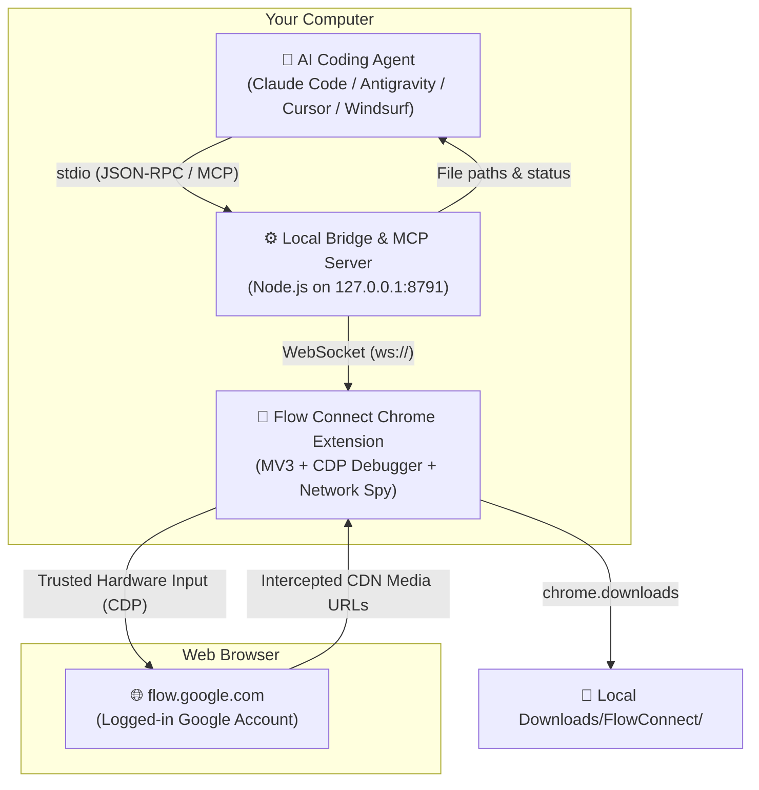

# ⚡ Flow Connect Free

<p align="center">
  <b>Connect your AI coding agent directly to Google Flow (Image & Video) via MCP — 100% Free & Open Source.</b>
</p>

<p align="center">
  
  
  
  
</p>

---

## 📖 Overview

**Flow Connect Free** is an open-source bridge that enables AI coding assistants (**Claude Code**, **Antigravity**, **Cursor**, **Windsurf**, and any MCP client) to generate images and videos directly on **[Google Flow](https://flow.google.com)** using your existing, logged-in Google account.

* **No API Keys or Costs:** Uses your own browser session.
* **No Paid Subscription Paywalls:** Unlike commercial alternatives, this tool has no artificial rate limits, cooldown paywalls, or single-image batch restrictions.
* **Nano Banana Pro & Veo 3.1:** Full support for high-resolution images and cinematic AI videos.
* **Local & Private:** Runs entirely on your machine via local loopback (`127.0.0.1:8791`). Zero telemetry or external licensing servers.

---

## 🏗️ Architecture



### How It Works:
1. **Trusted Hardware Events (CDP):** Google Flow ignores synthetic JavaScript clicks (`event.isTrusted === false`). Our extension uses the Chrome DevTools Protocol (`chrome.debugger`) to dispatch hardware-level mouse clicks and keystrokes.
2. **MAIN-World Response Spy:** A lightweight network spy runs at `document_start` in the MAIN world, hooking `window.fetch` and `XMLHttpRequest`. The moment Google Flow's backend finishes rendering, the clean CDN media URL is captured instantly.
3. **Automated Reference Uploads:** Traps native OS file pickers and programmatically injects local reference images using `DataTransfer`, allowing automated Image-to-Image and multi-ingredient video prompts.
4. **Local Download Manager:** Automatically downloads finished images/videos into `Downloads/FlowConnect/` and hands the local file paths directly back to your AI agent.

---

## 🚀 Quick Setup Guide

### Prerequisites
* **Google Chrome** or **Microsoft Edge**
* **Node.js 18+** installed ([nodejs.org](https://nodejs.org))
* A Google account signed into [flow.google.com](https://flow.google.com)

---

### Step 1: Install & Build
Clone the repository or extract the release zip:
```bash
git clone https://github.com/your-username/flow-connect-free.git
cd flow-connect-free
npm install
npm run build
```
*(If using the pre-built zip, `npm run build` is already completed!)*

---

### Step 2: Load Extension into Chrome / Edge
1. Open Chrome and go to `chrome://extensions` (or `edge://extensions` in Edge).
2. Enable **Developer mode** (toggle switch in the top-right corner).
3. Click **Load unpacked** (top-left).
4. Select the directory:
   ```
   path/to/flow-connect-free/packages/extension/dist
   ```
5. Click the extension icon in your browser toolbar to open the **Flow Connect Free Side Panel**.

---

### Step 3: Open Google Flow
1. Open a tab to **[flow.google.com](https://flow.google.com)** and sign in to your Google account.
2. **Important Display Arrangement:** Keep the Google Flow browser tab **visible on screen** (e.g. browser on the left half of the screen, code editor on the right half). Chrome throttles timers and rendering in minimized or fully covered tabs!

---

### Step 4: Start the Local Bridge Daemon
Run the bridge daemon in a terminal:
```bash
npm run start
```
To verify that everything is connected, run:
```bash
node packages/bridge/dist/cli.js status
```
You should see:
```text
=== Flow Connect Status ===
Bridge:              🟢 up (v1.0.0)
Chrome Extension:    🟢 Connected (v1.0.0)
Google Flow Tab:     🟢 Open and visible
Google Sign-in:      🟢 Logged in
Active Jobs:         0
```

---

### Step 5: Configure Your Coding Agent (MCP)

#### For Antigravity, Cursor, or Windsurf
Add `flow-connect` to your MCP configuration file (`mcp_config.json`):
```json
{
  "mcpServers": {
    "flow-connect": {
      "command": "node",
      "args": [
        "C:/Developments/FlowConnectFree/packages/bridge/dist/mcp-entry.js"
      ]
    }
  }
}
```
*(Replace the path with the absolute path to your `packages/bridge/dist/mcp-entry.js`)*

#### For Claude Code
Run in your terminal:
```bash
claude mcp add flow-connect node C:/Developments/FlowConnectFree/packages/bridge/dist/mcp-entry.js
```

---

## 🛠️ MCP Tools Reference

| Tool Name | Parameters | Description |
|---|---|---|
| `flow_status` | *none* | Check whether bridge daemon, Chrome extension, and Google Flow tab are connected and ready. |
| `flow_text_to_image` | `prompt`<br>`aspect_ratio` (16:9, 9:16, 1:1, 4:3, etc.)<br>`model` (nano-banana-pro, nano-banana-2)<br>`outputs` (1-4)<br>`folder` | Generates high-resolution images using Google's Nano Banana models. |
| `flow_image_to_image` | `prompt`<br>`image_paths` (array of local file paths)<br>`aspect_ratio`<br>`model` | Generates an image variation guided by one or more reference images. |
| `flow_text_to_video` | `prompt`<br>`duration` (4s, 6s, 8s, 10s)<br>`aspect_ratio` (16:9, 9:16)<br>`model` (veo-3.1-fast, veo-3.1-quality, omni-flash) | Generates cinematic video clips using Google Veo 3.1 or Omni Flash. |
| `flow_frame_to_video` | `prompt`<br>`image_paths` (start frame and optional end frame)<br>`duration` | Generates a video transitioning smoothly from a start frame to an end frame. |
| `flow_ingredients_to_video` | `prompt`<br>`image_paths` (up to 7 images)<br>`duration` | Generates videos with multiple character, prop, and style reference images. |
| `flow_extend_video` | `prompt` | Extends and lengthens the clip currently selected in Google Flow's scene editor. |
| `flow_list_jobs` | *none* | Lists recent generation jobs and their downloaded file paths. |
| `flow_get_job` | `job_id` | Checks status or waits for an ongoing generation. |

---

## 💬 Example Agent Prompts

Once configured, you can talk to your coding agent naturally:

* *"Generate a 16:9 photorealistic image on Google Flow of a cyberpunk street in Tokyo under neon rain."*
* *"Create a Dodge Challenger SRT drag racing against a supersonic fighter jet on an airport runway."*
* *"Make a 6-second video using Veo of a drone flying through a sunset canyon."*
* *"Take this character portrait at `./hero.png` and generate an image of him in medieval armor."*

The agent calls the tool, Google Flow generates the asset in your browser, and the completed file is saved to your computer and returned to the agent automatically.

---

## 💻 Command Line Interface (CLI)

You can also generate media directly from your command line:

```bash
# Check status
node packages/bridge/dist/cli.js status

# Generate an image
node packages/bridge/dist/cli.js generate flow-text-to-image \
  --prompt "A cozy cabin in snowy mountains at dusk, 8k" \
  --aspect-ratio 16:9

# Generate a video with Veo
node packages/bridge/dist/cli.js generate flow-text-to-video \
  --prompt "Ocean waves crashing violently against coastal cliffs" \
  --duration 6s \
  --aspect-ratio 16:9
```

---

## ❓ Troubleshooting

| Issue | Solution |
|---|---|
| `Flow tab: HIDDEN / MINIMIZED` | Chrome throttles background tabs. Keep the browser window open and visible on screen (not minimized or covered by another full-screen window). |
| `Could not communicate with Flow page` | Go to `chrome://extensions`, click **Reload (🔄)** on Flow Connect Free, then press **F5** on your `flow.google.com` tab once. |
| `Port 8791 in use` | Another instance of the bridge server is already running. Check with `Get-NetTCPConnection -LocalPort 8791` (Windows) or `lsof -i :8791` (macOS/Linux). |

---

## 📄 License & Disclaimer

* **License:** [MIT](LICENSE) — free for personal and commercial use.
* **Disclaimer:** This project is an independent open-source tool and is not affiliated with, endorsed by, or sponsored by Google LLC. Product names (Google Flow, Veo, Nano Banana) are used solely to indicate compatibility. Use responsibly and in accordance with website terms.
